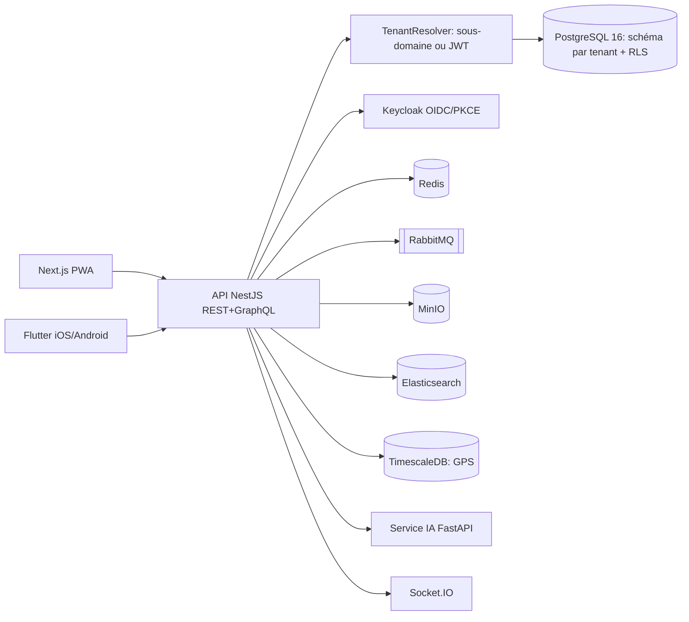
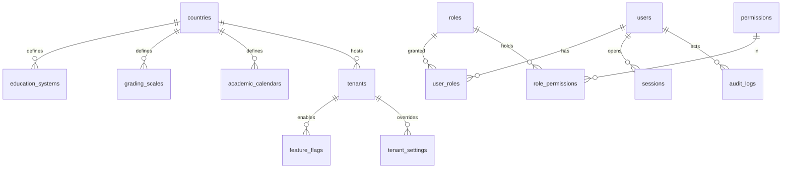

# Architecture

- **Cœur invariable + modules** (`packages/modules/*`, manifeste JSON conforme à `module-oaa` du CDC 4.4) chargés par un Module Registry (Phase 1).
- **Multi-tenant** : `public` (pays, tenants, users, rôles, audit) + `tenant_<slug>` par établissement, RLS forcée via `app.tenant_id`; contournement root via `app.root_bypass` (audité côté API). Voir `infra/sql/010_core.sql`.
- **Référentiel pays** : `countries`, `education_systems`, `grading_scales`, `academic_calendars` (+ surcharge `tenant_settings`). Aucun barème en dur ; moteur dans `packages/shared/src/grading.ts`.
- **Adaptateurs externes** : chaque service (paiement, push, SMS, email, cartes, LLM) = interface + implémentation `live` + `sandbox`, choisie par variable `*_MODE`.
- **Mobile** : Flutter, découverte des modules actifs via l'API du tenant, base locale chiffrée + file de synchro (Phase 2).

## ERD (noyau, Phase 0)

Les tables par domaine (élèves, notes, EDT, paiements, GPS, IA, etc., CDC 5.3) sont ajoutées par phase, dans le schéma tenant.
